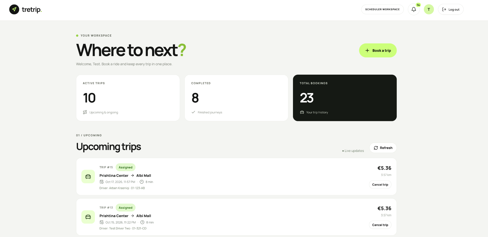
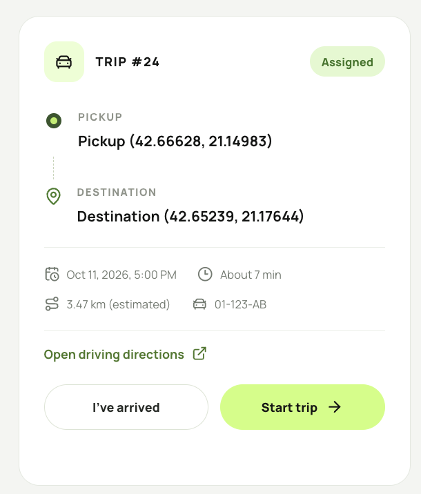
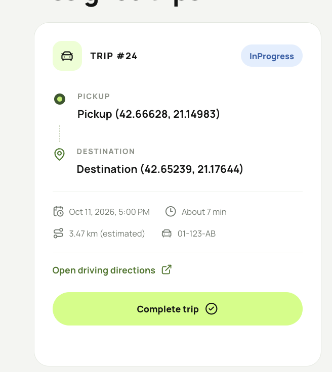
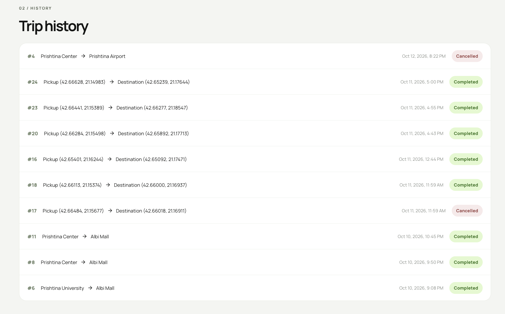
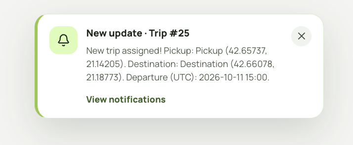
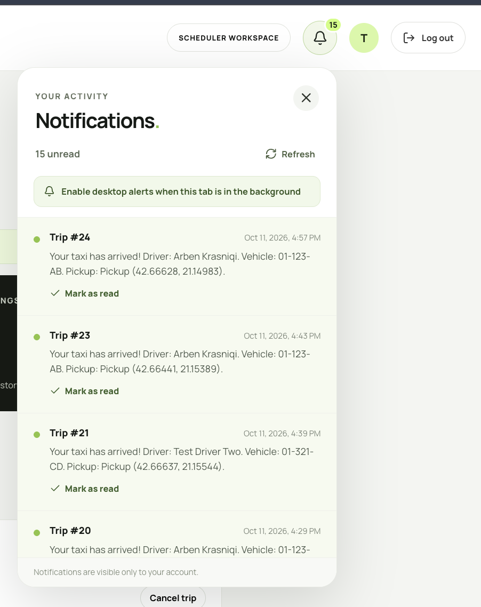
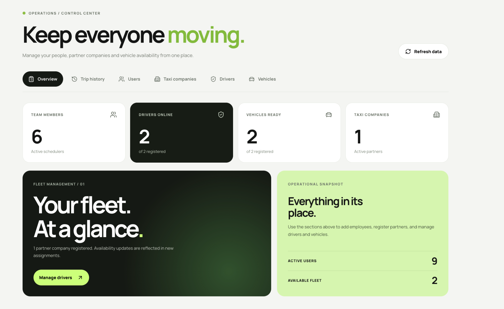
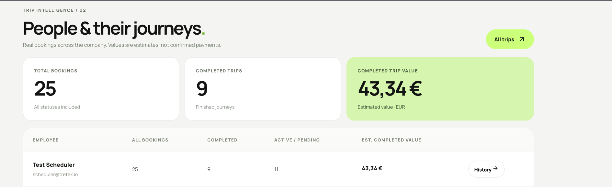
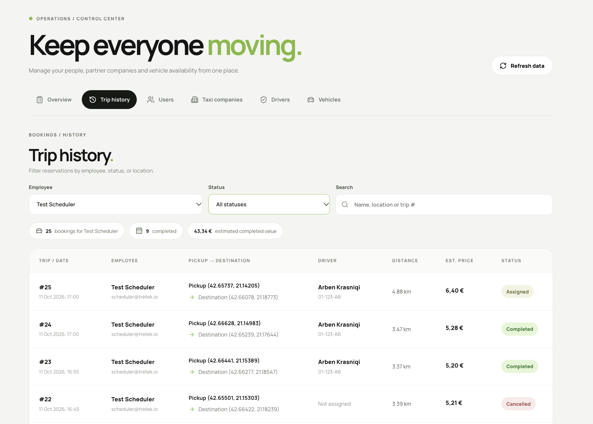

# TreTrip — Corporate Mobility Platform

TreTrip is a full-stack, role-based web application for scheduling company taxi journeys and coordinating employees, partner taxi drivers, and fleet administrators. It was built as an interview take-home project for a Tretek employee mobility use case.

The application provides trip booking, automatic assignment of available drivers and vehicles, trip lifecycle management, administration, trip history, and real-time updates.

> **Project scope:** TreTrip is a local-development MVP. Distance, travel time, and prices are estimates, not live road-routing or processed payments.

## Table of contents

- [Application preview](#application-preview)
- [Features](#features)
- [Tech stack](#tech-stack)
- [Architecture](#architecture)
- [Prerequisites](#prerequisites)
- [Local setup](#local-setup)
- [Demo workflow](#demo-workflow)
- [Testing and build](#testing-and-build)
- [Selected API routes](#selected-api-routes)
- [Limitations and next steps](#limitations-and-next-steps)
- [Repository layout](#repository-layout)

## Application preview

The screenshots below were captured from the running TreTrip MVP with demonstration data. The interface is designed for three roles: Scheduler, Driver, and Admin.

### 1. Sign in

A simple entry point for employees, administrators, and partner drivers, with role-based routing after authentication.


### 2. Scheduler workspace

Employees can review active and completed bookings, inspect their upcoming trips, and start a new reservation. Trip status is synchronized with the driver's actions.



### 3. Driver trip lifecycle

Assigned rides display the pickup and destination, departure time, distance estimate, vehicle plate, and driving directions. The available actions depend on the booking's status and timing rules.

| Assigned — ready for driver actions | In progress — completion available |
| :---: | :---: |
|  |  |

Completed, cancelled, and other past rides can be reviewed in the Driver trip history.



### 4. Live notifications

When a notification arrives while the app is open, a toast appears automatically. The notification remains available in the bell's activity panel until it is marked as read. Optional desktop alerts require browser permission.

| Real-time toast | Persistent notification center |
| :---: | :---: |
|  |  |

### 5. Admin operations and reporting

The Admin workspace provides an operational overview of employees, available drivers and vehicles, and taxi partners.



Admins can view booking totals, completed trips, and the **estimated** value of completed journeys by employee. These are estimates, not settled payments.



The company-wide trip history supports filtering and provides details about employees, drivers, origins, destinations, distances, estimated prices, and statuses.



---

## Features

| Role | Capabilities |
| --- | --- |
| **Scheduler** | Sign in; choose pickup and destination on a map; select departure date/time; review an estimated distance, duration, and fare; book or cancel eligible trips; view current trips and history; receive driver-arrival notifications. |
| **Driver** | See only assigned trips; open driving directions; report arrival; start and complete eligible trips; review trip history; receive new-assignment notifications. |
| **Admin** | Manage employees, taxi partner companies, drivers, and vehicles; control availability and account status; view company-wide bookings, employee trip history, and estimated completed-trip value. |

Additional capabilities:

- JWT authentication and role-based authorization (`Admin`, `Scheduler`, `Driver`).
- First-login password changes, password reset links, hashed passwords, token versioning, and login rate limiting/lockout.
- Company email restriction (`@tretek.io`) for new Scheduler accounts; external email addresses are allowed for partner drivers.
- Conflict-aware driver and vehicle assignment; pending trips can be reconsidered by a background worker.
- SignalR trip updates between Scheduler and Driver without a manual refresh, with periodic polling as a fallback.
- In-app notification bell with unread counts, a notification history, **Mark as read**, and transient toast alerts. Optional desktop alerts require browser permission.

## Tech stack

**Frontend:** React 19, TypeScript, Vite 8, React Router, Leaflet / OpenStreetMap, Lucide icons, SignalR JavaScript client.

**Backend:** ASP.NET Core / .NET 10, Entity Framework Core 10, PostgreSQL via Npgsql, JWT Bearer authentication, SignalR.

**Testing:** xUnit, ASP.NET Core integration tests, and Testcontainers for PostgreSQL.

## Architecture

```text
               React + TypeScript (Vite)
           Scheduler | Driver | Admin UI
                          |
               REST API + SignalR
                          |
                   ASP.NET Core
          Authentication / domain services
          Trip assignment / notifications
                          |
                Entity Framework Core
                          |
                      PostgreSQL

           Mailpit (optional local SMTP)
                Password-reset testing
```

The backend is the authoritative source for trip status and assignment. SignalR prompts the UI to refetch current data after an event. Real-time communication is available to authenticated users only.

## Prerequisites

- .NET SDK **10**
- Node.js and npm compatible with the project's Vite version
- PostgreSQL (running locally or in Docker)
- Docker Desktop **for integration tests** using Testcontainers
- `dotnet-ef` CLI for database migrations
- Optional: Mailpit for local password-reset emails

Install the EF CLI if necessary:

```bash
dotnet tool install --global dotnet-ef
```

If already installed, use `dotnet tool update --global dotnet-ef` when needed.

## Local setup

### 1. Clone the repository

```bash
git clone https://github.com/DiellzaJ/tretrip.git
cd tretrip
```

### 2. Prepare a PostgreSQL database

Create an empty PostgreSQL database, for example named `tretrip`. You can use a local PostgreSQL installation or a Docker container. Point `ConnectionStrings:DefaultConnection` to **your own** database.

For a temporary local-only Docker database, this is one possible example (replace `CHOOSE_A_LOCAL_PASSWORD` before running):

```bash
docker run -d --name tretrip-postgres \
  -e POSTGRES_DB=tretrip \
  -e POSTGRES_USER=tretrip \
  -e POSTGRES_PASSWORD=CHOOSE_A_LOCAL_PASSWORD \
  -p 5432:5432 postgres:16
```

If port `5432` is already in use or PostgreSQL is already running, reuse your existing setup instead of creating a second server.

### 3. Configure backend secrets

**Never commit real passwords, JWT signing keys, or SMTP credentials.** In the API project, use the .NET user-secrets store for local development:

```bash
dotnet user-secrets set "ConnectionStrings:DefaultConnection" "Host=localhost;Port=5432;Database=tretrip;Username=tretrip;Password=CHOOSE_A_LOCAL_PASSWORD" --project backend/TreTrip.Api

dotnet user-secrets set "Jwt:Key" "REPLACE_WITH_A_RANDOM_32_PLUS_CHARACTER_SECRET" --project backend/TreTrip.Api
dotnet user-secrets set "Jwt:Issuer" "TreTrip" --project backend/TreTrip.Api
dotnet user-secrets set "Jwt:Audience" "TreTripFrontend" --project backend/TreTrip.Api

dotnet user-secrets set "SeedAdmin:Email" "manager@tretek.io" --project backend/TreTrip.Api
dotnet user-secrets set "SeedAdmin:Password" "REPLACE_WITH_A_STRONG_12_PLUS_CHARACTER_PASSWORD" --project backend/TreTrip.Api
```

Replace the placeholder values with your own **local test values**. Do not use another person's real corporate email account or password. The Development-only admin seeder creates an initial administrator **only when the database contains no Admin user** and the seed settings are present. The admin email must end in `@tretek.io` and the seed password must be at least 12 characters.

### 4. Apply database migrations

```bash
dotnet ef database update \
  --project backend/TreTrip.Api \
  --startup-project backend/TreTrip.Api
```

Run migrations before starting the API so its tables and seeded roles exist.

### 5. Start the backend

```bash
dotnet run --project backend/TreTrip.Api --launch-profile http
```

- API: **http://localhost:5166**
- Swagger UI in Development: **http://localhost:5166/swagger**
- SignalR hub: **http://localhost:5166/hubs/notifications**

Keep this terminal running.

### 6. Start the frontend

In another terminal:

```bash
cd frontend
npm ci
npm run dev
```

Open **http://localhost:5173**. By default, the React client connects to `http://localhost:5166`. To override that API origin, set the frontend environment variable `VITE_API_URL` in a local `.env` file (which is ignored by Git).

### 7. Optional: password reset using Mailpit

Mailpit captures test emails locally. They are **not** sent to real inboxes.

```bash
docker run -d --name tretrip-mailpit \
  -p 1025:1025 -p 8025:8025 axllent/mailpit
```

Configure the API to use it:

```bash
dotnet user-secrets set "Smtp:Host" "localhost" --project backend/TreTrip.Api
dotnet user-secrets set "Smtp:Port" "1025" --project backend/TreTrip.Api
dotnet user-secrets set "Smtp:FromEmail" "no-reply@localhost.test" --project backend/TreTrip.Api
dotnet user-secrets set "Smtp:AllowInsecureLocal" "true" --project backend/TreTrip.Api
dotnet user-secrets set "Security:FrontendUrl" "http://localhost:5173" --project backend/TreTrip.Api
```

Restart the API after setting the values. Open **http://localhost:8025** to view password-reset links. The reset links expire in **15 minutes**. For real email delivery, an authorized production SMTP provider and configuration are required.

## Demo workflow

1. Log in with the initial Admin account defined in local user-secrets.
2. In **Admin**, register a partner taxi company and a vehicle, then create a driver and one or more Scheduler employees. Configure driver and vehicle availability.
3. Sign in as a Scheduler; choose pickup and destination pins on the map, choose a future departure time, and create a trip.
4. Open the account of the **driver actually assigned** to the booking. A live assignment and notification should appear there. With multiple drivers, the assignment might not go to the account opened in a different tab.
5. Use **I've arrived**, **Start trip**, and **Complete** when the trip's time and status allow. The Scheduler UI should reflect the transitions automatically.
6. Try a permitted cancellation, inspect trip history, and review company-wide history under Admin.
7. Open the notification bell, choose **Mark as read**, and reload the page to confirm that read status persists.

### Booking and status rules

Trips use the following statuses:

```text
Pending -> Assigned -> Arrived -> InProgress -> Completed
       \-> Cancelled (where permitted)
       \-> Expired   (pending bookings past their valid time)
```

A trip can remain `Pending` if no eligible driver/vehicle pair is available. A background worker retries pending assignments periodically. The API enforces transition and timing rules; buttons may be disabled until a transition becomes valid.

## Testing and build

From the repository root:

```bash
dotnet build TreTrip.sln
dotnet test TreTrip.sln
```

The integration tests use **Testcontainers for PostgreSQL**; ensure Docker Desktop is running before testing.

Frontend production build:

```bash
cd frontend
npm ci
npm run build
```

At the time of the final local checks, **49 of 49 backend tests passed**, and the frontend production build passed. A Vite warning about a JavaScript chunk exceeding 500 kB is a bundle-size warning, not a build failure.

## Selected API routes

| Area | Route | Purpose |
| --- | --- | --- |
| Auth | `POST /api/auth/login` | Sign in |
| Auth | `POST /api/auth/change-password` | Change authenticated account password |
| Auth | `POST /api/auth/forgot-password` | Request reset link |
| Auth | `POST /api/auth/reset-password` | Set new password using reset token |
| Scheduler | `GET /api/trips` | Retrieve own bookings |
| Scheduler | `POST /api/trips` | Book a trip |
| Scheduler | `PATCH /api/trips/{id}/cancel` | Cancel an eligible owned trip |
| Admin | `GET /api/admin/trips` | Company-wide trip list for Admin |
| Notifications | `GET /api/notifications` | Get authenticated user's notifications |
| Notifications | `PATCH /api/notifications/{id}/read` | Mark one owned notification as read |
| Live | `/hubs/notifications` | Authenticated SignalR events |

See Swagger UI for the complete available API surface.

## Limitations and next steps

- **Routing/ETA:** The Leaflet map supports pin selection using OpenStreetMap. Distances use a Haversine estimate multiplied by a factor, with estimated duration and pricing. No live route-engine traffic ETA is provided. External driving directions can be opened separately.
- **Payments:** Displayed prices and Admin completed-trip values are estimates, not processed or settled payments.
- **Notifications:** Some trip lifecycle transitions trigger real-time refreshes without generating a persisted notification message. App toast/bell updates work while the authenticated app is open; fully closed-browser push would require a service worker and Web Push infrastructure.
- **Email:** Mailpit is local-only; production email delivery requires an approved provider. Restricting employees to `@tretek.io` validates the address format/domain but does not itself prove mailbox ownership.
- **Production:** Add deployment configuration, HTTPS, environment-specific CORS, monitoring, persistent secret management, paginated Admin analytics, and more exhaustive security tests before using with real company data.
- **Visual assets:** Confirm that any third-party illustration has an appropriate reuse/distribution license before distributing the repository publicly.

## Repository layout

```text
TreTrip.sln
backend/
  TreTrip.Api/              ASP.NET Core controllers, services, EF models/migrations, SignalR hub
  TreTrip.Api.Tests/        Unit and integration tests
frontend/
  public/                   Static assets
  src/
    api/                   API client/auth
    features/admin/        Admin operations and trip history
    features/scheduler/    Booking, map and own trips
    features/driver/       Assigned trips and driver trip lifecycle
    features/security/     Password recovery/change screens
    features/notifications/ Notification bell, read state and toast UI
    realtime/              SignalR subscription
```

---

**TreTrip** — *Your taxi is here.*
